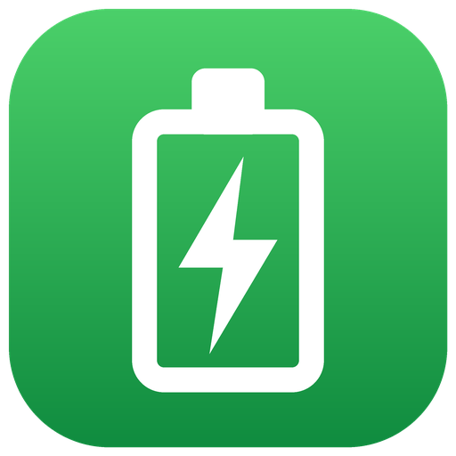

  

<h1 align="center">Green Cell USV für Home Assistant</h1>

  
  
  
  

<a href="README.md">🇬🇧 English</a>

Integration für **Green-Cell-USVs**, die per USB an einem PC mit der **GC UPS App** hängen.
Die App bringt einen Webserver mit (Angular-Oberfläche + JSON-API); die Integration meldet
sich dort an und fragt lokal ab — ohne Cloud, ohne NUT.

> [!WARNING]
> **Early-Access-Beta.** Getestet gegen die API der GC UPS App 1.1.x mit einer Green-Cell-USV. Fehlt ein Wert oder stimmt etwas nicht, bitte ein [Issue](https://github.com/marcbuetti/ha-greencell-ups/issues/new/choose) mit Diagnose-Datei aufmachen.

## Was es gibt

- **Status**: Netzbetrieb / Akkubetrieb / Akku schwach / Selbsttest / Störung / Abschaltung
  läuft / USV nicht verbunden (USB)
- Akkustand, Akkuspannung, Ein- und Ausgangsspannung, Netzfrequenz, Last, **Ausgangsleistung
  (geschätzt: Last × Nennleistung)**, Temperatur (nur mit Fühler)
- Netzspannung, Akkubetrieb, Akku schwach, Lädt, Störung, Abschaltung läuft
- Diagnose: USB-Verbindung, Selbsttest läuft, AVR aktiv, Signalton, Nennwerte
- *Optional* (in den Optionen „Steuerung erlauben"): Akku-Selbsttest (10 s), Signalton umschalten

Abschaltbefehle und der lange Akkutest werden **nie** angeboten.

## Voraussetzungen

1. USV per USB am PC (Windows/Linux) mit installierter GC UPS App — oder ohne Bildschirm
   im Docker-Container, siehe [fajfer/gcups](https://github.com/fajfer/gcups).
2. In der App **Einstellungen → HTTP-Server einschalten** (Port 8080) und Passwort setzen.
   Test: `http://<pc>:8080/api/status` antwortet `1`.
3. Home Assistant ab **2025.2** (das Integrations-Icon braucht **2026.3+**).

## Installation über HACS

Oder von Hand:
1. HACS → ⋮ → **Benutzerdefinierte Repositories**
2. `https://github.com/marcbuetti/ha-greencell-ups`, Typ **Integration** → Hinzufügen
3. **Green Cell UPS** suchen → Herunterladen
4. Home Assistant neu starten

Manuell: den Ordner `custom_components/greencell_ups` nach `/config/custom_components/` kopieren und HA neu starten.

## Einrichtung

Oder: **Einstellungen → Geräte & Dienste → Integration hinzufügen → Green Cell UPS**
- Host: IP des PCs mit der App, optional mit `:Port`
- Passwort: das aus „Connect remotely" der Weboberfläche. Einen Benutzernamen gibt es nicht.

Unter **Konfigurieren**: Abfrageintervall (Standard 10 s) und „Steuerung erlauben". Unter **Neu konfigurieren**: neue Adresse, falls der PC eine andere IP bekommt.

## Dashboard

[`dashboard/gc-ups-dashboard.de.yaml`](dashboard/gc-ups-dashboard.de.yaml) ist ein fertiges Dashboard mit Status, Akku- und Last-Anzeige, Ausgangsleistung, 24-h-Verlauf und Details — nur eingebaute Karten.

**Einstellungen → Dashboards → Dashboard hinzufügen → Neues Dashboard von Grund auf** → öffnen → ⋮ → Bearbeiten → ⋮ → **Raw-Konfigurationseditor** → einfügen → Speichern. Die Entity-IDs sind sprachunabhängig (`sensor.gc_ups_battery_level`).

## Fallen der API (am echten Gerät gemessen)

- Login-Körper mit einem zusätzlichen Feld (z. B. `username`) → **403**; falsches
  Passwort → **401**.
- Über HTTP kommt camelCase (`batteryLevel`, `utilityFail`), nicht die snake_case-Namen aus
  dem JavaScript.
- `offline: true` ist **keine Störung**, sondern die Bauart.
- Negative Werte = „weiß ich nicht" → *unbekannt*. `0` bleibt gültig.
- Ohne USB (`connected: false`) liefert die App Platzhalter (`failed: true` …). Dann steht
  der Status auf „USV nicht verbunden" und alle Messwerte sind *nicht verfügbar* — kein
  Fehlalarm.

## USV mit Netzwerk statt USB?

Geprüft (Nov. 2026): Eine Green-Cell-USV oder Netzwerkkarte, die diese API selbst anbietet,
gibt es nicht. Die API stammt aus der GC UPS App auf dem PC, nicht aus der USV. Eine
künftige Netzwerkkarte würde eher SNMP sprechen (→ SNMP- oder NUT-Integration). Ins Netz
bringt man die USV mit einem dauerhaft laufenden PC/NAS/VM mit der App oder einem
Raspberry Pi mit dem Docker-Image [fajfer/gcups](https://github.com/fajfer/gcups).

## Fehlersuche

Lesend prüfen, ohne Passwort in der Shell-History:
`GCUPS_HOST=10.25.14.4 GCUPS_PASSWORD=… python tools/probe.py`

## Hinweis

Community-Projekt, **keine Verbindung zu Green Cell / CSG S.A.** Lizenz: [MIT](LICENSE)
