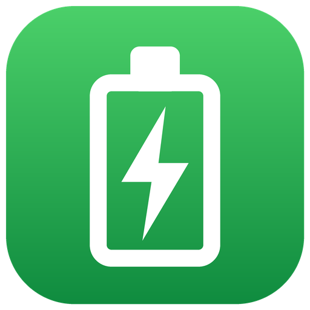

<p align="center">
  
</p>

<h1 align="center">Green Cell UPS for Home Assistant</h1>

<p align="center">
  <a href="https://github.com/hacs/integration"></a>
  
  <a href="https://github.com/marcbuetti/ha-greencell-ups/releases"></a>
  <a href="https://github.com/marcbuetti/ha-greencell-ups/actions/workflows/validate.yml"></a>
</p>

<p align="center"><a href="README.de.md">🇩🇪 Deutsche Anleitung</a></p>

Home Assistant integration for **Green Cell UPS units** connected via USB to a PC that runs
the vendor's **GC UPS App**. The app has a built-in web server (Angular UI + JSON API); this
integration logs in to that API and polls it locally — no cloud, no NUT driver needed.

> [!WARNING]
> **Early access beta.** Tested against the API of the GC UPS App 1.1.x with a Green Cell line-interactive UPS. Please [open an issue](https://github.com/marcbuetti/ha-greencell-ups/issues/new/choose) with your diagnostics file if a value is missing or wrong.

## What you get

| Entity | Source |
|---|---|
| **Status** (online / on battery / battery low / self-test / fault / shutdown pending / UPS not connected) | derived, most severe first |
| Battery level, battery voltage | `batteryLevel`, `batteryVoltage` |
| Input / output voltage, input frequency | `inputVoltage`, `outputVoltage`, `inputFrequency` |
| Load (%) and **output power (W, estimated)** = load × rated power | `load`, spec `power` |
| Temperature (only if the UPS has a probe) | `temperature` |
| Mains power, On battery, Battery low, Charging, Fault, Shutdown pending | flags |
| Diagnostic: USB connection, self-test running, AVR active, beeper, rated power/VA, nominal voltages | |
| *Optional* buttons: battery self-test (10 s), toggle beeper | `POST /api/commands` |

"Charging" is derived, not reported: on mains, a 12 V lead-acid block sits at 13.5–13.8 V,
above the app's `batteryVoltageHighNominal`, and drops below it when discharging. The
"charging" label in the vendor UI is a fixed text.

Shutdown commands (`shutdownOrder`, `shutdownAndRestoreOrder`) and the long battery test are
**never** exposed. A smart home that can switch off the UPS it monitors is a risk.

## Requirements

1. The UPS is plugged into a PC (Windows or Linux) via USB, with the
   [GC UPS App](https://greencell.global/en/gcnews/premieres/latest-release-of-green-cell-ups-app)
   installed — or headless in Docker, see [fajfer/gcups](https://github.com/fajfer/gcups).
2. In the app: **Settings → enable HTTP server** (default port 8080) and set a password.
   Check in a browser: `http://<pc>:8080` shows the UI, `http://<pc>:8080/api/status` answers `1`.
3. Home Assistant **2025.2** or newer (the integration icon needs **2026.3+**).

## Installation

### HACS (recommended)

[](https://my.home-assistant.io/redirect/hacs_repository/?owner=marcbuetti&repository=ha-greencell-ups&category=integration)

Or manually in HACS:
1. HACS → ⋮ → **Custom repositories**
2. Repository: `https://github.com/marcbuetti/ha-greencell-ups`, type: **Integration** → Add
3. Search for **Green Cell UPS** → Download
4. Restart Home Assistant

### Manual

Copy `custom_components/greencell_ups` to `<config>/custom_components/greencell_ups` and restart Home Assistant.

## Configuration

[](https://my.home-assistant.io/redirect/config_flow_start/?domain=greencell_ups)

Or: **Settings → Devices & services → Add integration → Green Cell UPS**

| Field | Value |
|---|---|
| Host | IP or name of the PC running the app, optionally with port (`10.0.0.20` or `10.0.0.20:8085`) |
| Password | the one from "Connect remotely" in the app's web UI — there is no user name |

**Configure** on the integration: polling interval (default 10 s) and *Allow control* (adds the self-test and beeper buttons). **Reconfigure** changes the address if the PC gets a new IP.

## Dashboard

[`dashboard/gc-ups-dashboard.yaml`](dashboard/gc-ups-dashboard.yaml) ([German](dashboard/gc-ups-dashboard.de.yaml)) is a ready-made dashboard: status, battery and load gauges, output power, 24 h history and details. Built-in cards only.

**Settings → Dashboards → Add dashboard → New dashboard from scratch** → open it → ⋮ → Edit → ⋮ → **Raw configuration editor** → paste → Save.

Entity IDs don't depend on your HA language (e.g. `sensor.gc_ups_battery_level`), so the dashboard works as-is. A second UPS gets `_2` appended.

## API notes (measured on a real installation)

```
GET  /api/status                 -> "1"   (no login)
POST /api/login {"password":…}   -> 201 {access_token}   (JWT)
GET  /api/current_parameters     Bearer
GET  /api/nominal_parameters     Bearer
GET  /api/device/specification   Bearer
GET  /api/data                   Bearer   manufacturer, vendor, protocol, info
POST /api/commands {"action":"shortTestOrder","args":{}}   Bearer
```

- **The login body schema is strict.** An extra field such as `username` gives **403**, a
  wrong password **401**. Don't read a 403 as "wrong auth method".
- Field names over HTTP are **camelCase** (`batteryLevel`, `utilityFail`); the snake_case
  names in the UI bundle are route names. Both are accepted.
- **`offline: true` is not a fault.** It describes the topology (line-interactive instead of
  double conversion) and is `true` in normal operation.
- **Negative numbers mean "unknown"**: `-1` without a temperature probe or USB link → shown
  as *unknown*, never as "−1 °C". `0` stays valid (0 V input = no mains).
- Without USB (`connected: false`) the app reports placeholders like `failed: true` and
  `shutdownActive: true`. The integration then shows **Status = UPS not connected** and
  marks all measured entities unavailable — no false alarm, no plausible-looking zeros.
- The token is kept until rejected; then the integration logs in again and retries **once**
  (survives app restarts, which silently invalidate tokens).

## Green Cell UPS with network instead of USB?

Checked (Nov 2026): Green Cell does not sell a UPS or network card that serves this API
directly. The API comes from the GC UPS App (Electron + Express) on the PC, not from the UPS.
Green Cell's rack/RTII line is not documented with an SNMP slot either; if a model with a
network card shows up, it would most likely speak SNMP, not this API (→ use HA's SNMP or NUT
integration for that). Ways to get the UPS "on the network" with this integration:

- any always-on PC/NAS/VM with USB passthrough running the GC UPS App,
- a Raspberry Pi / Linux box with the Docker image [fajfer/gcups](https://github.com/fajfer/gcups).

Alternatively, many Green Cell models work with NUT (`nutdrv_qx`), see the
[NUT hardware list](https://networkupstools.org/ddl/Greencell/PowerProof_2000.html).

## Troubleshooting

- *Cannot connect:* PC asleep, HTTP server not enabled in the app, firewall on port 8080.
- *Password rejected:* the app answers 401 — check the password in the web UI.
- *Everything unavailable, status "UPS not connected":* the app runs but does not see the UPS
  on USB (cable, driver, wrong USB device in Docker).
- Check from a shell, without storing the password in history:
  `GCUPS_HOST=10.0.0.20 GCUPS_PASSWORD=… python tools/probe.py` (read-only).

## Development

```bash
pip install aiohttp pytest pytest-asyncio
python -m pytest tests
```

## Disclaimer

Community project, **not affiliated with or endorsed by Green Cell / CSG S.A.** The integration only talks to the GC UPS App on your own PC: read access, plus the two optional harmless commands.

## License

[MIT](LICENSE)
